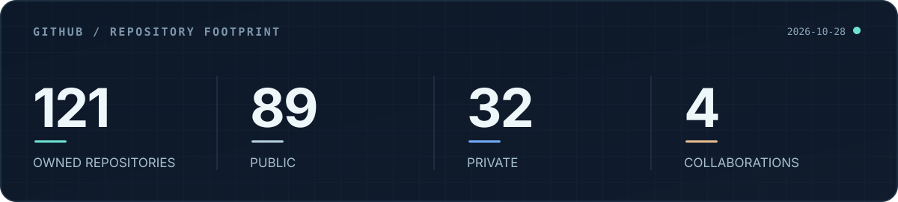
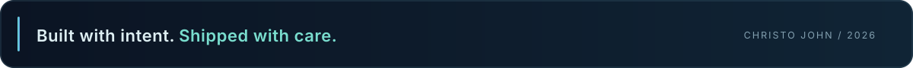

  

   

  <a href="https://tesnic.vercel.app"><strong>Portfolio</strong></a>
  &nbsp;&nbsp;·&nbsp;&nbsp;
  <a href="https://www.linkedin.com/in/christo-john-kalapurackal/"><strong>LinkedIn</strong></a>
  &nbsp;&nbsp;·&nbsp;&nbsp;
  <a href="mailto:10.christojohn@gmail.com"><strong>Email</strong></a>

 

### I build the product and the systems behind it.

I'm **Christo John** — a design-minded, full-stack engineer working across **product development, applied AI, automation, and cloud infrastructure**.

I like the difficult middle: turning an idea into a working interface, connecting it to real systems, handling edge cases, and taking it all the way to deployment.

From Figma to frontend. From database contracts to background workers. From first prototype to a product someone can actually use.

 

### Selected work

<table>
  <tr>
    <td width="50%" valign="top">
      
01 / CREATIVE INFRASTRUCTURE

      
<strong>Video creation, engineered end to end.</strong>

      
A browser-based creative platform backed by asynchronous rendering, cloud workers, object storage, and reliable export workflows.

      
<code>Next.js</code> · <code>Remotion</code> · <code>AWS</code> · <code>TypeScript</code>

    </td>
    <td width="50%" valign="top">
      
02 / DATA &amp; DECISION SYSTEMS

      
<strong>Turning fragmented data into clear decisions.</strong>

      
Research and analytics interfaces built around normalization, source provenance, secure data boundaries, and trustworthy calculations.

      
<code>PostgreSQL</code> · <code>Supabase</code> · <code>SQL</code> · <code>React</code>

    </td>
  </tr>
  <tr>
    <td width="50%" valign="top">
      
03 / CONNECTED PRODUCTS

      
<strong>Making complex integrations feel simple.</strong>

      
Full-stack product experiences built around external data services, localization, authentication, payments, and AI-assisted interactions.

      
<code>Next.js</code> · <code>Django</code> · <code>REST APIs</code> · <code>Python</code>

    </td>
    <td width="50%" valign="top">
      
04 / AUTOMATION &amp; OPERATIONS

      
<strong>Workflows designed for more than the happy path.</strong>

      
Cross-platform automation with authenticated callbacks, explicit states, recovery paths, and reconciliation when external systems are uncertain.

      
<code>Webhooks</code> · <code>Playwright</code> · <code>Docker</code> · <code>n8n</code>

    </td>
  </tr>
</table>

 

### In the open

<a href="https://github.com/christo-zero-john/virtual-background-photobooth"><strong>Virtual Background Photobooth ↗</strong></a>

Real-time background replacement in the browser, with QR-based phone pairing, photo delivery, and remote shutter control. Built with **MediaPipe, WebGL, and Supabase**.

 

### Engineering stack

| | |
| :-- | :-- |
| **Frontend** | TypeScript, JavaScript, React, Next.js, Tailwind CSS |
| **Backend & data** | Python, Django, PostgreSQL, Supabase, REST APIs |
| **Cloud & infrastructure** | AWS, Google Cloud, Docker, Vercel, S3, Lambda, SQS |
| **AI, automation & media** | LLM integrations, Codex, Claude Code, Playwright, Remotion, FFmpeg |
| **Design & quality** | Figma, Vitest, Testing Library, Playwright E2E |

 

### By the numbers

  

 

### Beyond the code

**Full-stack engineering** for startups and client products. Previously worked across **product engineering and UI design at Neuegrid Design Studio**, and **full-stack development at Tomatrix Technologies**. Pursuing an **MCA (2025–2027)** after completing a **BCA (2022–2025)**.

 

<strong>Good products need thoughtful engineering.</strong>

<a href="mailto:10.christojohn@gmail.com">Let's work together</a>
&nbsp;&nbsp;·&nbsp;&nbsp;
<a href="https://tesnic.vercel.app">tesnic.vercel.app</a>

  

