<!-- REFINED_PROFILE_V2 -->

  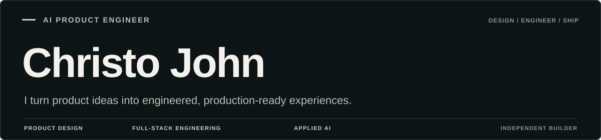

<a href="https://tesnic.vercel.app">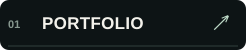</a>&nbsp;&nbsp;<a href="https://www.linkedin.com/in/christo-john-kalapurackal/">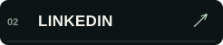</a>&nbsp;&nbsp;<a href="#selected-work">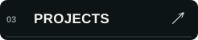</a>&nbsp;&nbsp;<a href="mailto:10.christojohn@gmail.com">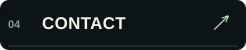</a>

### Building with purpose.

I'm **Christo John**, an AI Product Engineer. I design interfaces, build full-stack systems, and put applied AI to work inside real products—from Figma and Next.js to Supabase, infrastructure, and automated workflows.

### The engineering record

<a href="./docs/github-audit/REPORT.md">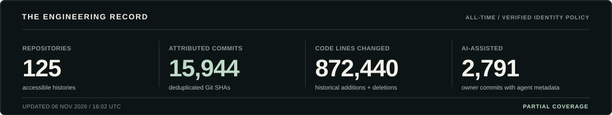</a>

Last recalculated 06 Nov 2026 / 18:02 UTC · Coverage: Partial. 15,944 exact-email attributed Git SHAs; any provisional Christo-name matches are disclosed in the audit. Code lines changed = cumulative additions + deletions in qualifying non-merge commits, not unique original code. All accessible remote refs are scanned. Private repository names are intentionally omitted from this public profile.

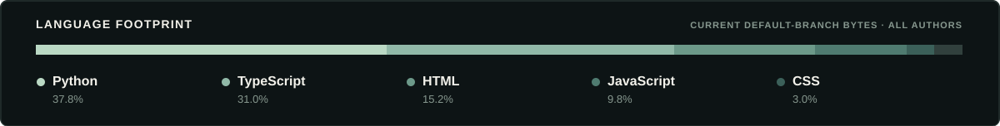

<a href="./docs/github-audit/REPORT.md">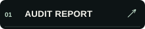</a>&nbsp;&nbsp;<a href="./docs/github-audit/repositories.md">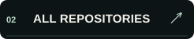</a>&nbsp;&nbsp;<a href="./docs/github-audit/languages.md">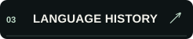</a>&nbsp;&nbsp;<a href="./docs/github-audit/APPENDIX.md">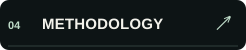</a>

### Selected work

Public projects · Project figures reflect attributed Git history, not total upstream repository activity.

<a href="https://github.com/christo-zero-john/virtual-background-photobooth">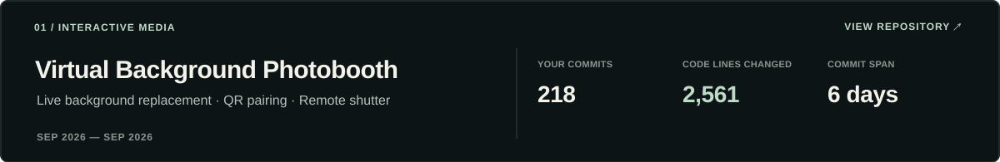</a>

<a href="https://github.com/christo-zero-john/movie-watch-history-tracker-webapp">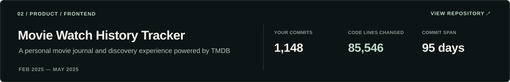</a>

<a href="https://github.com/christo-zero-john/complaint-management-system">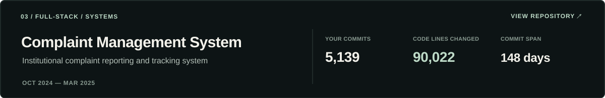</a>

<a href="https://github.com/christo-zero-john/roco-the-agentic-car">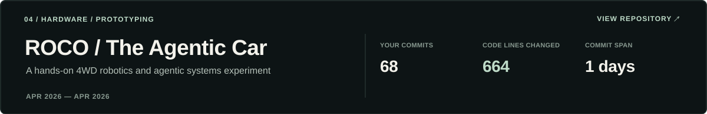</a>

<strong>How these project numbers are measured</strong>

Commits are attributed using the account-linked Christo identity rules; unrelated upstream authors and standalone agents are excluded. Agent-assisted owner commits count once. Changed code lines include additions and deletions, not surviving source or work hours. The commit span is the calendar difference between first and last qualifying commit author dates—not time actively spent working. For detailed repository evidence and exclusions, open the linked audit using the navigation above.

### The toolkit

**Primary** · Next.js / Supabase / Figma / Claude Code / Codex

**Also working with** · TypeScript / React / Python / Django / PostgreSQL / Tailwind CSS / Docker / Vercel / AWS / Playwright

Technologies are self-reported experience; the language chart above is a current all-author repository snapshot.

---

<strong>Thoughtful interfaces. Serious engineering.</strong>

&nbsp;&nbsp;&nbsp;&nbsp;

GitHub profile data regenerated from the strict lifetime audit. The layout intentionally uses static, accessible vector graphics; no flashing GIFs, fragile JavaScript, or decorative badges.
