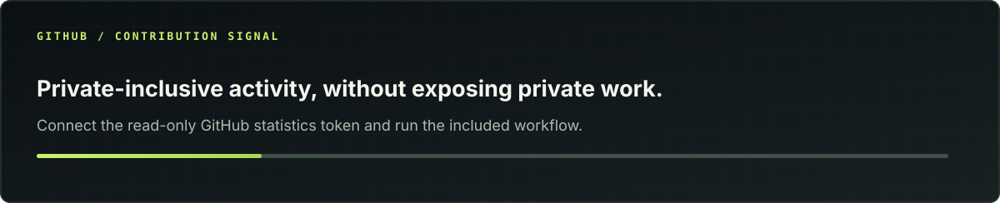

<!--
  GitHub profile README · Christo John
  Public-safe by design: NO private repository links, client names, or private source data.
  The stats images in ./assets are generated from aggregate GitHub metadata.
-->

 

  

---

### `01 / Who I am`

I'm **Christo John**, a software engineer based in Kerala, India. I build **end-to-end digital products** at the intersection of **full-stack engineering, applied AI, design, and cloud infrastructure**.

My work spans product discovery, system architecture, frontend and backend implementation, data modeling, integrations, automated testing, deployment, and production debugging. My background in UI design shapes how I approach usability; my work with AI coding agents shapes how I approach engineering speed **without giving up verification or ownership**.

> **My approach:** Understand the problem. Define the system. Build the smallest reliable solution. Verify it. Ship it. Improve it.

<table>
<tr>
<td width="50%" valign="top">
<strong>CURRENT FOCUS</strong>
<ul>
<li>AI-native applications and agentic workflows</li>
<li>Full-stack product engineering</li>
<li>Distributed jobs, cloud media pipelines, and automation</li>
<li>Data integrity, authorization, and reliable integrations</li>
</ul>
</td>
<td width="50%" valign="top">
<strong>HOW I ENGINEER</strong>
<ul>
<li>Architecture before unnecessary complexity</li>
<li>Explicit data and security boundaries</li>
<li>Test, type-check, lint, build, and review</li>
<li>Design systems and thoughtful user experience</li>
<li>AI-assisted engineering with human accountability</li>
</ul>
</td>
</tr>
</table>

### `02 / The work behind the profile`

Much of my recent engineering has been developed in **private repositories** for client engagements, internal products, or commercially sensitive systems. I respect those boundaries: **I do not publish private code, project identifiers, customer data, or confidential implementation details.**

Instead, this profile shows **anonymized engineering capabilities** and an **aggregate, private-inclusive repository footprint**.

Repository counts include private repositories accessible to the authenticated account, **without revealing which repositories they are**. Counts describe repositories, not individual authored commits or sole ownership of collaborative work. Automated refresh requires the included GitHub Actions setup.

### `03 / Selected engineering work`

<table>
<tr>
<td width="50%" valign="top">
<strong>01 — Cloud video &amp; creative tooling</strong>

Built systems for browser-driven video capture and programmable video rendering using <strong>Next.js, Playwright, FFmpeg, Remotion, AWS Lambda, SQS, S3, and Docker</strong>.

<em>Engineering emphasis:</em> asynchronous jobs, direct-to-object-storage uploads, render status, failure recovery, payment-safe workflows, and independently deployed workers.

</td>
<td width="50%" valign="top">
<strong>02 — Data products &amp; analytics</strong>

Developed research dashboards that turn imperfect source records into defensible, inspectable decisions using <strong>TypeScript, PostgreSQL, Supabase, SQL, and browser-level verification</strong>.

<em>Engineering emphasis:</em> data provenance, normalization, reconciliation, read-only boundaries, authorization, and correctness of derived metrics.

</td>
</tr>
<tr>
<td width="50%" valign="top">
<strong>03 — AI-enabled business applications</strong>

Worked on client-facing product experiences involving <strong>Django/DRF, Next.js, REST APIs, structured data mapping, translation, information enrichment, and AI assistants</strong>.

<em>Engineering emphasis:</em> converting ambiguous requirements into maintainable systems, handling unreliable external sources, and communicating technical trade-offs.

</td>
<td width="50%" valign="top">
<strong>04 — Workflow &amp; publishing infrastructure</strong>

Engineered content and workflow automation involving <strong>authenticated webhooks, object storage, third-party APIs, and stateful reconciliation</strong>.

<em>Engineering emphasis:</em> idempotency, explicit state machines, secure service boundaries, and distinguishing confirmed failures from uncertain outcomes.

</td>
</tr>
</table>

Project details above are intentionally generalized and represent categories of work—not an invitation to access confidential repositories.

### `04 / Public code you can explore`

These are **publicly inspectable projects**; my more recent client and internal work is generally not public.

| Project | What it demonstrates | Stack |
| :-- | :-- | :-- |
| **[Virtual Background Photobooth](https://github.com/christo-zero-john/virtual-background-photobooth)** | Real-time background segmentation, WebGL camera processing, QR-based phone pairing, remote shutter and photo delivery | MediaPipe · WebGL · JavaScript · Supabase |
| **[Mu Companion](https://github.com/christo-zero-john/mu-companion-webapp)** | Early community-focused task management and web application development | Next.js · JavaScript |
| **[Complaint Management System](https://github.com/christo-zero-john/complaint-management-system)** | Authentication, complaints workflow, status tracking and admin-side operations | PHP · MySQL · JavaScript |

<a href="https://github.com/christo-zero-john?tab=repositories&type=public"><b>Explore all public repositories ↗</b></a>

### `05 / Tools and technologies`

**Application development**

**Data, cloud and systems**

**AI, automation and media**

### `06 / Development activity`

When enabled, this chart uses the authenticated GitHub contribution calendar and can incorporate eligible private activity. It never exposes private repository names. Contributions are **not** equivalent to authored commits; GitHub applies its own contribution-counting rules.

### `07 / Experience & background`

- **Full Stack Engineer · Freelance** — building product features and integrations for international clients.
- **Full Stack / AI-Native Engineer · Neuegrid Design Studio** — full-stack applications, cloud-backed media tools, and automation.
- **Full Stack Developer Intern · Tomatrix Technologies** — learning-platform features, authentication, payments, and backend integrations.
- **UI Design Intern · Neuegrid Design Studio** — interface design, prototyping, Figma, and usability.

Currently pursuing an **MCA (2025–2027)**, building on a **BCA (2022–2025)**.

---

**Have an interesting engineering problem?**

I'm interested in **product engineering**, **applied AI**, **cloud systems**, and **well-defined freelance collaborations**.

<a href="mailto:10.christojohn@gmail.com"><b>EMAIL</b></a> &nbsp;·&nbsp;
<a href="https://www.linkedin.com/in/christo-john-kalapurackal/"><b>LINKEDIN</b></a> &nbsp;·&nbsp;
<a href="https://tesnic.vercel.app"><b>PORTFOLIO</b></a>

  

Thoughtful systems over loud claims. · Kerala, India

